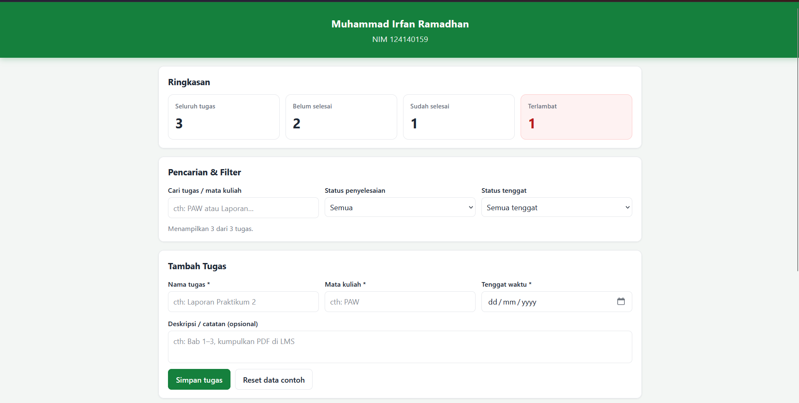
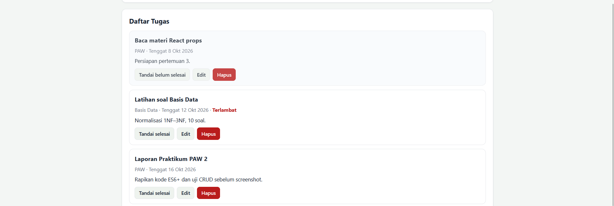

# Student Productivity Dashboard

Nama: Muhammad Irfan Ramadhan
NIM: 124140159
Praktikum Pengembangan Aplikasi Web — Pertemuan 2 (JavaScript ES6+)

## Tentang aplikasi

Aplikasi dashboard sederhana untuk mencatat tugas kuliah dan melihat progresnya.
Dibuat pakai HTML, CSS, dan JavaScript biasa (tanpa framework).

Fitur:
- Tambah, edit, hapus, dan tandai selesai tugas
- Ringkasan otomatis: total, belum selesai, sudah selesai, terlambat
- Cari berdasarkan nama tugas / mata kuliah + filter status
- Data tersimpan di localStorage jadi tidak hilang saat refresh
- Data awal diambil dari API JSONPlaceholder, kalau offline pakai data contoh lokal

## Cara menjalankan

1. Buka folder ini di VS Code
2. Klik kanan `index.html` / Open with Live Server

Harus lewat Live Server karena proyek ini pakai ES Modules.

## Screenshot

### Tampilan dashboard

### Daftar tugas

## Fitur ES6+ yang dipakai

| Materi | File | Lokasi |
|---|---|---|
| let dan const | `js/app.js` | `let seed` di `bootstrap` (baris 150); sisanya `const` |
| Arrow functions | `js/modules/utils.js` | baris 6, 12, 21, 32 |
| Template literals | `js/app.js` | `taskCardHTML`, baris 300 |
| Destructuring | `js/app.js` | baris 31, 44, 201, 301 |
| Spread | `js/app.js` | baris 57, 191 |
| Classes | `js/app.js` | `TaskItem` (baris 30), `DashboardApp` (baris 69) |
| Array methods | `js/app.js` | `map`, `filter`, `find`, `reduce` (baris 269), `sort` |
| Async/await | `js/modules/data.js`, `js/app.js` | `fetchSeedTasks` (`data.js` baris 68), `bootstrap` (`app.js` baris 141) |
| ES Modules | `js/main.js`, `js/app.js` | `import`/`export`, `<script type="module">` di `index.html` |

## Pengumpulan

Repo: `pemrograman_web_itera_124140159`
