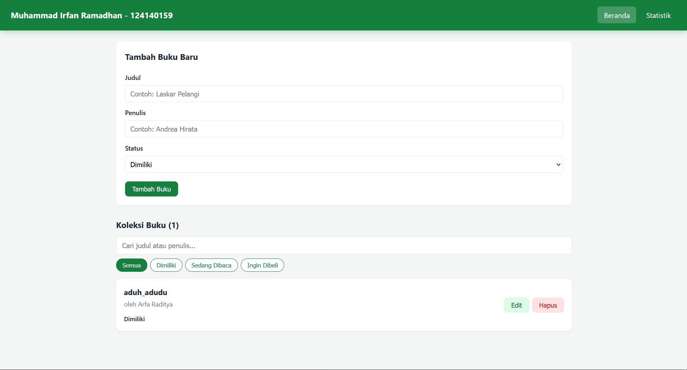
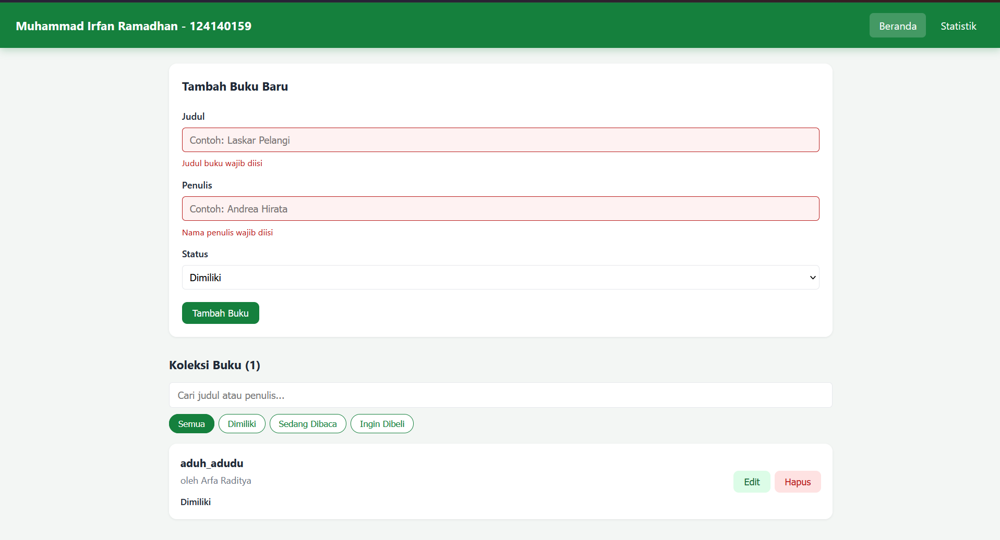
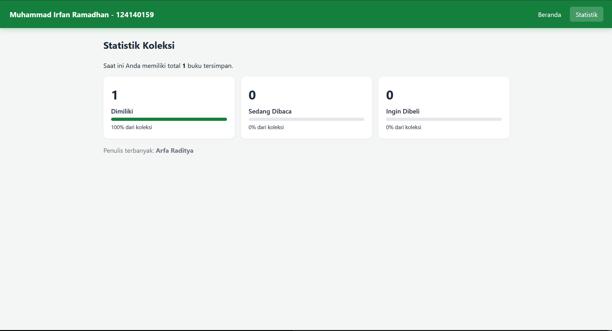
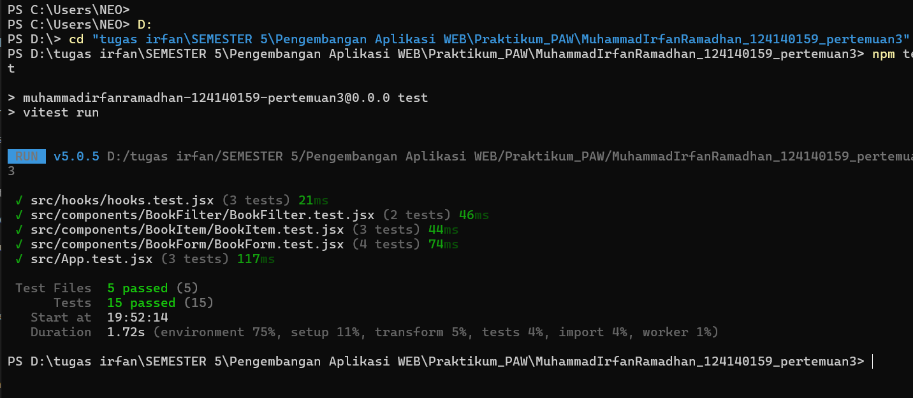

# Aplikasi Manajemen Buku Pribadi (Pertemuan 3)

Muhammad Irfan Ramadhan | 124140159 | Kelas RB

## Deskripsi

Aplikasi React untuk mencatat buku yang **dimiliki**, **sedang dibaca**, atau **ingin dibeli**. Pengguna bisa menambah, mengedit, menghapus, memfilter, dan mencari buku. Data disimpan di `localStorage`, jadi tidak hilang ketika halaman di-refresh. Halaman **Statistik** menampilkan ringkasan koleksi.

## Instalasi & Menjalankan

1. Buka folder repositori di **VS Code**.
2. Buka terminal VS Code (`Ctrl + ``) lalu jalankan:

```bash
cd MuhammadIrfanRamadhan_124140159_pertemuan3
npm install
npm run dev      # buka http://localhost:5173
npm test         # menjalankan unit test (Vitest + React Testing Library)
npm run build    # build produksi
```

## Screenshot

| Halaman | Gambar |
|---|---|
| Beranda (daftar buku) |  |
| Validasi form kosong |  |
| Halaman Statistik |  |
| Hasil unit test |  |

## Fitur

- Tambah buku (judul, penulis, status: milik / baca / beli)
- Edit dan hapus buku (dengan konfirmasi sebelum menghapus)
- Filter berdasarkan status
- Pencarian berdasarkan judul atau nama penulis
- Validasi form: kolom wajib diisi, border merah, dan pesan error
- Data tersimpan di localStorage
- Halaman Statistik (jumlah per status, persentase, penulis terbanyak) dan halaman 404

## Struktur Folder

```
src/
├── components/
│   ├── BookForm/     # form tambah/edit + validasi
│   ├── BookList/     # daftar buku
│   ├── BookItem/     # kartu satu buku
│   ├── BookFilter/   # pencarian + filter status
│   └── Navbar/       # navigasi antar halaman
├── pages/
│   ├── Home/         # halaman utama
│   ├── Stats/        # halaman statistik
│   └── NotFound/     # halaman 404
├── hooks/
│   ├── useLocalStorage.js
│   └── useBookStats.js
├── context/
│   └── BookContext.jsx
└── App.jsx
```

## Penerapan Konsep React

| Konsep | Penerapan |
|---|---|
| `useState` | State form, pesan error, kata kunci pencarian, filter status, dan buku yang sedang diedit |
| `useEffect` | Menyimpan data ke localStorage (`useLocalStorage`), mengisi ulang form saat mode edit, dan memperbarui judul tab browser |
| Komponen reusable | `BookForm`, `BookList`, `BookItem`, `BookFilter`, `Navbar` |
| Context API | `BookContext` menyediakan `books`, `addBook`, `updateBook`, `deleteBook` lewat hook `useBooks()` sehingga tidak ada prop drilling |
| React Router | `/` (Beranda), `/stats` (Statistik), `*` (404) dengan `NavLink` |
| Custom hooks | `useLocalStorage` (state yang tersinkron ke localStorage) dan `useBookStats` (hitung statistik dengan `useMemo`) |
| PropTypes | Dipasang di seluruh komponen yang menerima props |
| Error handling | `validateBook()` di `BookForm` dan `try/catch` saat membaca/menulis localStorage |

## Laporan Testing

Testing memakai **Vitest + React Testing Library**, dengan **15 test di 5 file**:

| File | Yang diuji |
|---|---|
| `BookForm.test.jsx` | Error saat form kosong, submit data valid (dengan trim), mode edit, `validateBook` |
| `BookItem.test.jsx` | Render data buku, tombol Hapus dan Edit memanggil callback |
| `BookFilter.test.jsx` | Input pencarian, tombol filter aktif dan callback |
| `hooks.test.jsx` | `useLocalStorage` menyimpan/membaca data, `useBookStats` menghitung statistik |
| `App.test.jsx` | Integrasi: tambah buku dan tersimpan ke localStorage, pencarian, hapus |

```
 Test Files  5 passed (5)
      Tests  15 passed (15)
```

Screenshot hasil eksekusi di terminal: `screenshots/04-hasil-test.png`.
