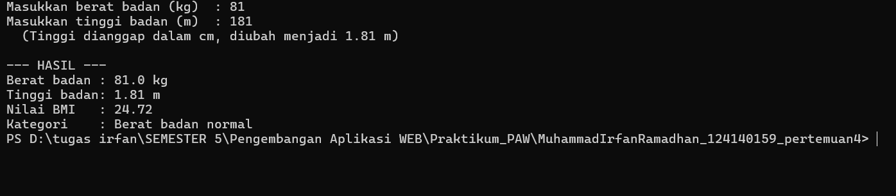
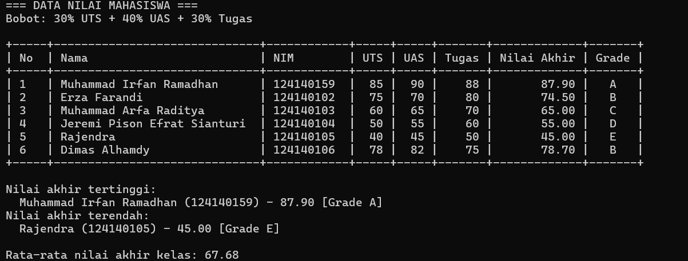
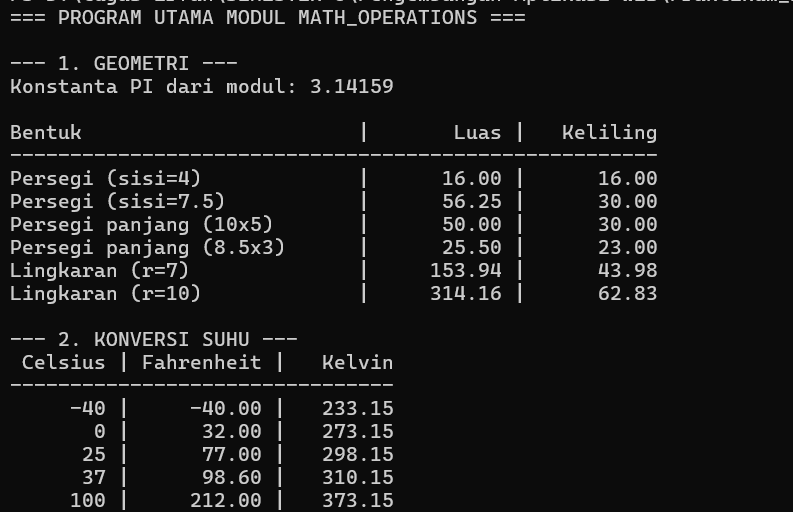

# Dasar Pemrograman Python

Nama: Muhammad Irfan Ramadhan
NIM: 124140159
Praktikum Pengembangan Aplikasi Web — Pertemuan 4 (Python Dasar)

## Tentang tugas

Tiga program Python sederhana yang dijalankan lewat terminal.

Isi tugas:
- `tugas1_bmi.py` — hitung BMI dari berat dan tinggi badan, lalu tentukan kategorinya
- `tugas2_nilai_mahasiswa.py` — hitung nilai akhir dan grade 6 mahasiswa, tampilkan dalam tabel beserta nilai tertinggi dan terendah
- `math_operations.py` — modul berisi fungsi luas & keliling (persegi, persegi panjang, lingkaran) dan konversi suhu
- `main.py` — program yang memakai semua fungsi dari `math_operations`

## Cara menjalankan

1. Buka folder ini di VS Code
2. Buka terminal, lalu jalankan:

```bash
python tugas1_bmi.py
python tugas2_nilai_mahasiswa.py
python main.py
```

Untuk `tugas1_bmi.py`, masukkan berat (kg) dan tinggi (m) saat diminta.

## Screenshot

### Soal 1 — Penghitung BMI


### Soal 2 — Nilai mahasiswa


### Soal 3 — Modul matematika


## Materi Python yang dipakai

| Materi | File |
|---|---|
| Variabel, input & f-string | `tugas1_bmi.py` |
| if-elif-else | `tugas1_bmi.py` (kategori BMI), `tugas2_nilai_mahasiswa.py` (grade) |
| Loop | `tugas2_nilai_mahasiswa.py`, `main.py` |
| List & dictionary | `tugas2_nilai_mahasiswa.py` |
| Fungsi & docstring | semua file |
| Modul & import | `math_operations.py`, `main.py` (`import ... as` dan `from ... import`) |
