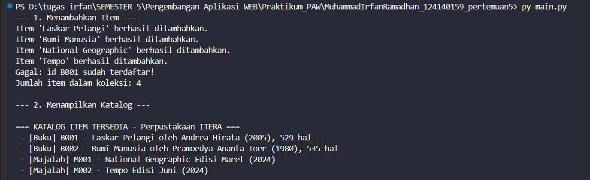
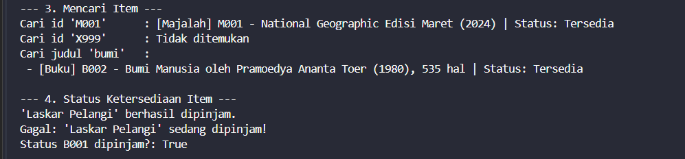
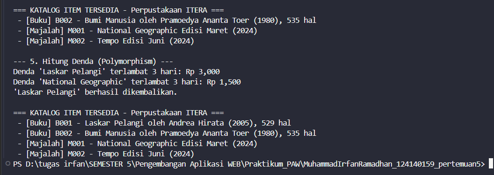

# Sistem Manajemen Perpustakaan Sederhana

Nama: Muhammad Irfan Ramadhan
NIM: 124140159
Kelas Praktikum: RB
Praktikum Pengembangan Aplikasi Web — Pertemuan 5 (Python OOP)

## Tentang program

Program Python untuk mengelola koleksi perpustakaan yang berisi buku dan majalah, dijalankan lewat terminal.

Alur program di `main.py`:
1. Membuat perpustakaan, lalu menambahkan 2 buku dan 2 majalah (item dengan id yang sama akan ditolak)
2. Menampilkan katalog item yang tersedia
3. Mencari item berdasarkan id dan judul
4. Meminjam buku, lalu menampilkan katalog lagi (buku yang dipinjam tidak muncul)
5. Menghitung denda keterlambatan, mengembalikan buku, dan menampilkan katalog lagi

Isi file:
- `library_item.py` — abstract class `LibraryItem` beserta subclass `Book` dan `Magazine`
- `library.py` — class `Library` untuk menyimpan dan mengelola koleksi item
- `main.py` — program untuk menguji semua fitur

## Penerapan OOP

| Konsep | Penerapan |
|---|---|
| Class & Object | `LibraryItem`, `Book`, `Magazine`, dan `Library` sebagai class; tiap buku dan majalah adalah object |
| Abstract Class & Inheritance | `LibraryItem(ABC)` punya abstract method `get_detail()` dan `hitung_denda()`. `Book` dan `Magazine` mewarisi `LibraryItem` dan wajib mengimplementasikan keduanya |
| Encapsulation | Atribut protected `_item_id`, `_judul`, `_tahun`; atribut private `__dipinjam` dan `__koleksi`; property `item_id`, `judul`, `is_dipinjam`, `jumlah_item` |
| Polymorphism | `get_detail()` dan `hitung_denda()` dipanggil dengan cara yang sama untuk semua item, tapi hasilnya beda sesuai jenisnya (denda buku Rp 1.000/hari, majalah Rp 500/hari) |

## Cara menjalankan

1. Buka folder ini di VS Code
2. Buka terminal, lalu jalankan:

```bash
python main.py
```

Cukup jalankan `main.py`, karena `library_item.py` dan `library.py` otomatis ikut dimuat lewat `import`.

## Screenshot

### Menambahkan item & menampilkan katalog


### Mencari item & status ketersediaan


### Katalog setelah dipinjam, hitung denda & katalog setelah dikembalikan

